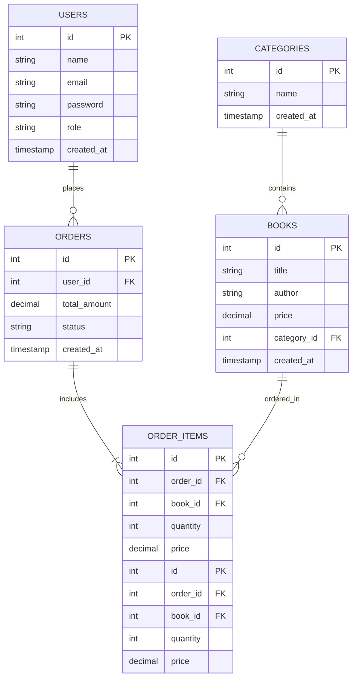

# Online Bookstore Management System Backend

A restful API backend for an Online Bookstore Management System built with Node.js, Express, and PostgreSQL. It includes secure user authentication (JWT) and dynamic book, category, and order management features with a full 5-table relational schema.

## 🚀 Live Deployment
- **Vercel URL:** [https://bookstore-backend-swart.vercel.app/](https://bookstore-backend-swart.vercel.app/)[cite: 1]
- **GitHub Repository:** [https://github.com/ronaakter12346i-design/bookstore-backend](https://github.com/ronaakter12346i-design/bookstore-backend)[cite: 1]

---

## 🛠️ Features & Tech Stack
- **Node.js & Express.js** for backend API framework.
- **PostgreSQL** for relational database architecture.
- **JWT (JSON Web Token)** for authorization and secure routes.
- **bcryptjs** for secure password hashing.
- **Vercel** for continuous cloud deployment.

---

## 🗄️ Database Schema / ERD (5 Tables)
Below is the structural entity-relationship diagram for the 5-table database:



## 📖 API Endpoints Documentation

### 🔑 Authentication
| Method | Endpoint | Description | Auth Required |
| :--- | :--- | :--- | :--- |
| `POST` | `/api/auth/register` | Register a new user | No |
| `POST` | `/api/auth/login` | User login & token generation | No |

### 📚 Categories
| Method | Endpoint | Description | Auth Required |
| :--- | :--- | :--- | :--- |
| `GET` | `/api/categories` | Get all categories | No |
| `POST` | `/api/categories` | Create a new category | Yes (Bearer Token) |

### 📖 Books
| Method | Endpoint | Description | Auth Required |
| :--- | :--- | :--- | :--- |
| `GET` | `/api/books` | Get all books | No |
| `GET` | `/api/books/:id` | Get single book details | No |
| `POST` | `/api/books` | Add a new book | Yes (Bearer Token) |
| `PUT` | `/api/books/:id` | Update book details | Yes (Bearer Token) |
| `DELETE` | `/api/books/:id` | Delete a book | Yes (Bearer Token) |


### 🛍️ Orders & Order Items Endpoints Documentation

#### 1. Place a New Order
- **Method** : `POST`
- **URL** : `https://bookstore-backend-swart.vercel.app/api/orders`
- **Description** : Creates a new order and records individual items in the `order_items` table using a transaction.
- **Headers** : 
  - `Content-Type: application/json`
  - `Authorization: Bearer <your_jwt_token>`
- **Request Body** :
  ```json
  {
    "items": [
      {
        "book_id": 1,
        "quantity": 2
      },
      {
        "book_id": 3,
        "quantity": 1
      }
    ]
  }
{
  "message": "Order placed successfully",
  "order": {
    "id": 5,
    "user_id": 2,
    "total_amount": 175000,
    "status": "pending",
    "created_at": "2026-10-25T12:00:00.000Z",
    "items": [
      { "book_id": 1, "quantity": 2, "price": 50000 },
      { "book_id": 3, "quantity": 1, "price": 75000 }
    ]
  }
}
{
  "error": "Book with ID 1 not found"
}
[
  {
    "id": 5,
    "user_id": 2,
    "total_amount": 175000,
    "status": "pending",
    "created_at": "2026-10-25T12:00:00.000Z"
  }
]
{
  "id": 5,
  "user_id": 2,
  "total_amount": 175000,
  "status": "pending",
  "created_at": "2026-10-25T12:00:00.000Z",
  "items": [
    {
      "id": 12,
      "order_id": 5,
      "book_id": 1,
      "quantity": 2,
      "price": 50000,
      "title": "Belajar Python",
      "author": "John Doe"
    }
  ]
}
{
  "error": "Order not found"
}
```
## ⚙️ How to Run Locally

1. **Clone the repository:**
2. **Install dependencies:**
3. **Configure Environment Variables:**
Create a `.env` file in the root directory and add:
4. **Start the server:**
